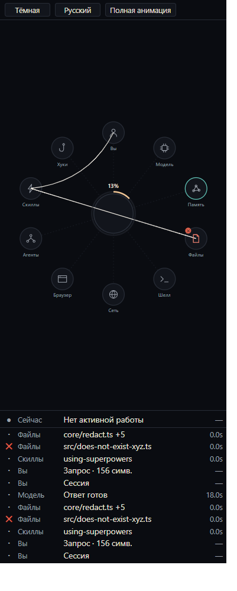
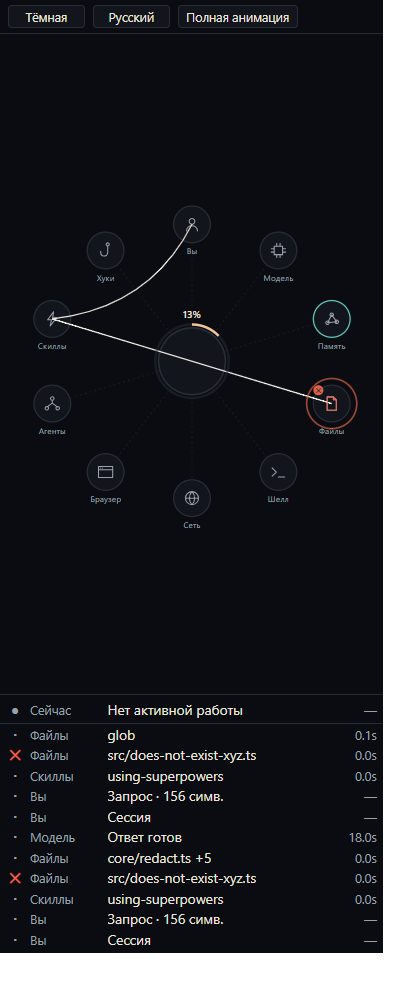
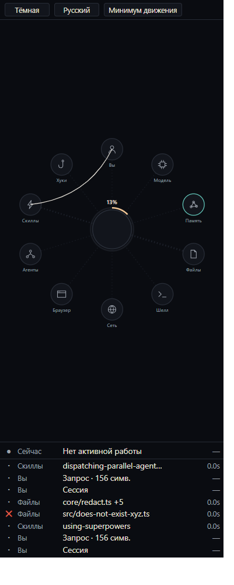

# ds-map

Живая карта работы агента рядом с чатом: отдельное окно-радар, которое в реальном
времени показывает, чем харнес занят — какие станции зажигаются, где ошибка,
сколько контекста потрачено. Никакого содержимого: только имена событий.

Порт [lot-map](https://github.com/alexeyw/lot-map) (MIT, Aleksei Volodin) на
[DeepSeek Harness](https://www.npmjs.com/package/@deepseek-ai/dsh) (`dsh`).
Геометрия станции-иконки и цветовые токены взяты оттуда же.

## Скриншоты

Тёмная тема, идёт работа (маршрут, пульсы, кольцо контекста):



Светлая тема + красные ошибки на станции `files`:


Крупный план ошибки (красная точка на узле и `✕` в ленте):



Режим «минимум движения»:



## Установка

```bash
pnpm install
pnpm build
node dist/cli.js doctor
```

## Запуск

Одной командой поднимается всё: сайдкар, харнес и окно панели.

```bash
node dist/cli.js run -- dsh --profile web          # долгая сессия в браузере
node dist/cli.js run -- dsh --profile headless "привет"   # один ход
```

Панель пристёгивается к окну терминала, из которого запущен лаунчер, и следует
за ним. Если окна нет (headless-запуск из службы, отсоединённый терминал),
панель встаёт у правого края экрана.

**Сколько живёт панель.** Ровно столько, сколько харнес. `--profile headless`
делает один ход и выходит — панель закроется сразу за ответом, это не падение.
Для долгой работы нужен профиль с сессией: `web` или `acp`.

**Нужен собранный `dist/`** (`pnpm build`) и установленный `dsh` в `PATH`.
Проверить одним шагом:

```bash
node dist/cli.js doctor
```

Он построчно говорит: Node, сборка, Electron, харнес, сессия для текущего cwd,
сайдкар, настройки. Файлы `~/.dsh/dsmap-port.txt` и `dsmap-token.txt` удаляются
при нормальном выходе; если лаунчер убили жёстко (`taskkill /F`, снятие в
диспетчере задач), их убирает панель — она замечает мёртвый порт через несколько
секунд, — или расширение VS Code, когда терминал закрыли без Ctrl-C. `✗ «порт из
файла не отвечает»` после такого убийства поэтому проходит само.

Для Windows удобно положить в `PATH` обёртку вида:

```bat
@echo off
node "C:\путь\к\ds-map\dist\cli.js" run -- dsh --profile headless %*
```

Остановка — `Ctrl-C` в том же терминале: лаунчер гасит харнес, панель и сайдкар,
сирот не остаётся. В Windows Terminal синтетический Ctrl-C дочерним процессам не
доставляется (ограничение conpty), поэтому проверенные пути остановки — настоящий
`Ctrl-C` в терминале VS Code и обычное завершение харнеса.

## Расширение VS Code

В каталоге [`extension/`](extension/) — обёртка для VS Code: команды
`ds-map: Start panel with harness`, `…Stop panel (send Ctrl-C)`, `…Run diagnostics`,
индикатор в статус-баре и настройки `dsMap.cliPath` / `dsMap.harnessCommand`.

```bash
pnpm package:extension                          # build/ds-map-<version>.vsix
code --install-extension build/ds-map-0.3.0.vsix
```

Готовый `.vsix` лежит в [последнем релизе](https://github.com/Bbotirov/ds-map/releases/latest).
В Marketplace расширение не опубликовано: для этого нужны аккаунт издателя и PAT —
`pnpm exec vsce publish` из собранного каталога (`build/extension`).

Расширение ничего не читает из сессий и не скачивает: оно только запускает
локальный CLI. Проверено в настоящем хосте расширений VS Code
(`extension/test-runner/run.js`), в два цикла: активация, регистрация команд,
`start` с поднявшимся окном панели и её решением о пристыковке, `stop` настоящим
`Ctrl-C`, после которого не остаётся ни терминала, ни окна, ни файлов
порта/токена, — и отдельный цикл на настоящем `dsh`: живой снимок карты плюс
требование, чтобы контрольный маркер промпта не появился ни в снимке, ни в
строках лаунчера.

`dsMap.cliPath` и `dsMap.harnessCommand` имеет смысл писать в **User**-settings,
тогда панели доступны в любом окне, а не только в папке ds-map. Если путь
относительный (`${workspaceFolder}/dist/cli.js`), расширение найдёт CLI только
с открытым проектом ds-map. Для `harnessCommand` берите долгий профиль
(`dsh --profile web`), иначе панель закроется вместе с первым ответом.

## Как это работает

```
dsh ──session.v4.jsonl──► tailer ──route/classify/redact──► WS 127.0.0.1 ──► окно Electron
```

Источник событий — хвост `~/.dsh/sessions/--<cwd>--/<session>/session.v4.jsonl`.
У `dsh` нет настраиваемого `base_url` и нет собственного TUI-окна, поэтому
хвост сессионного журнала — единственный способ получать события, не трогая
сам харнес. Подробности: [docs/ARCHITECTURE.md](docs/ARCHITECTURE.md),
разведка: [docs/DISCOVERY.md](docs/DISCOVERY.md).

## Станции

У каждой станции своя иконка в центре узла; цвет иконки — состояние станции.

| Станция | Иконка | Что зажигает |
| --- | --- | --- |
| `you` | человек | сообщения пользователя |
| `model` | чип | шаги модели, переключение ответа |
| `memory` | нейросеть | память и MCP-серверы (своя бирюзовая пара) |
| `files` | документ | чтение/запись/правка файлов, glob, grep |
| `shell` | `>_` | шелл-команды |
| `web` | глобус | web fetch/search |
| `browser` | окно браузера | браузерные инструменты |
| `agents` | дерево процессов | субагенты, фоновые работы |
| `skills` | молния | скиллы |
| `hooks` | крючок | хуки |

## Приватность (условие существования)

- **Только имена, никогда содержимое.** Ни промптов, ни текста файлов, ни
  командных строк, ни результатов инструментов. В ленте подписи строятся из
  имён инструментов и имён аргументов (`src/core/redact.ts`).
- **Никаких сетевых запросов наружу.** Ни телеметрии, ни проверки обновлений,
  ни CDN-шрифтов. Работает с выключенной сетью.
- **Сервер только на `127.0.0.1`**, порт случайный, токен в файле с правами
  `600`, проверяется на каждом запросе.
- **Ничего не хранится между сессиями.** Файлы порта и токена удаляются при
  выходе; состояние живёт только в окне.
- **Fail-open.** Сбой маппера или отсутствующий лог не роняет харнес: панель
  молча теряет события, агент продолжает работать.
- **Отладочный лог не содержит содержимого** — только имена событий и тайминги.
- `.env` и каталог данных сессий `.dsh/` в `.gitignore`; в историю коммитов они
  не попадали.

## Разработка

```bash
pnpm typecheck          # src + extension
pnpm lint
pnpm test               # vitest, 18 файлов / 346 тестов
pnpm test:coverage      # покрытие core/ >= 80% (порог в vitest.config.ts)
pnpm build              # dist/ для CLI и окна
pnpm package:extension  # .vsix
```

Прогон расширения в настоящем хосте VS Code (не юнит-тест, а реальный
`Code.exe`; нужны свежие `dist/` и `build/extension`, то есть `pnpm build` и
`pnpm package:extension` перед ним):

```bash
code --user-data-dir <пустая папка> --disable-workspace-trust \
  --extensionDevelopmentPath "<repo>/build/extension" \
  --extensionTestsPath "<repo>/extension/test-runner/run.js" "<repo>"
```

Тест поднимает панель, читает её строку о пристыковке, гасит настоящим `Ctrl-C`
и проверяет, что не осталось ни терминала, ни окна, ни файлов порта/токена;
настройки он возвращает к `undef`, чтобы прогоны не наследовали друг друга.
Отчёт пишется в `build/extension-tests.log` (`DSMAP_TEST_REPORT` перебивает
путь) — самого вывода `Code.exe` при «пристыковке» к открытому окну хватает не
всегда.

## Лицензия

MIT. См. [LICENSE](LICENSE) — там же отметка о происхождении геометрии из
lot-map (MIT, Aleksei Volodin).
