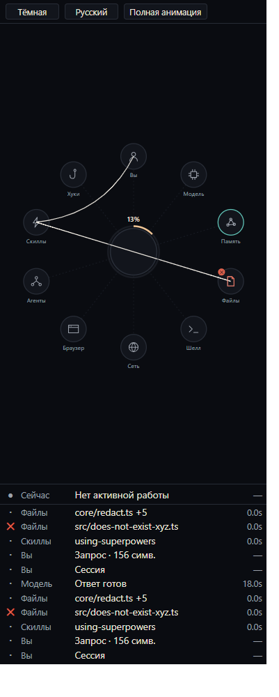

# ds-map — radar panel for DeepSeek Harness

A live radar of what the agent is doing: 10 stations (`you`, `model`, `memory`,
`files`, `shell`, `web`, `browser`, `agents`, `skills`, `hooks`), the route
between them, red error markers and a real context ring. It runs as a **view
inside VS Code** — «Карта работы ds-map» in the Secondary Sidebar — and, for
everything outside the editor, as its own Electron window.

## What this extension does

It starts the harness **together with** the ds-map launcher inside VS Code's
integrated terminal, so one command brings up the sidecar, the harness and the
panel, and `Ctrl-C` in that terminal takes all of it down. The view then attaches
to the sidecar over a local WebSocket **from the extension host** and receives
only map snapshots.

The view opens by itself once per live harness session (a session whose file was
written to in the last 90 seconds). A view you hide yourself stays hidden for the
rest of that session; disable the behaviour with `dsMap.autoOpen`.

| Command | What it does |
| --- | --- |
| `ds-map: открыть карту` | Focuses the «Карта работы ds-map» view |
| `ds-map: выбрать сессию` | Lists recorded sessions of this folder — id and write time only |
| `ds-map: скопировать снимок карты (JSON)` | Puts the current snapshot on the clipboard |
| `ds-map: карта в браузере` | Writes the snapshot as a static page and opens it externally |
| `ds-map: проиграть последнюю запись` | Reconnects to the sidecar, which replays its recent buffer |
| `ds-map: запустить панель с харнесом` | Opens a `ds-map` terminal and runs `node <cli> run -- <harness command>` |
| `ds-map: остановить панель (Ctrl-C)` | Sends a real `Ctrl-C` (0x03) into that terminal, then closes it if it survived |
| `ds-map: диагностика` | Runs `dsmap doctor` and shows the output in the ds-map log channel |

A status-bar item shows whether the panel is up and links to the diagnostics.
The window and the tab never fight over the screen: whichever surface is showing
the map refreshes `~/.dsh/dsmap-dock.<pid>.json` every 2 s, and a crashed process
leaves a file that expires by itself.

## Requirements

ds-map itself must be built (`pnpm install && pnpm build`) — the extension only
launches it and reads its local port/token files. It looks for `dist/cli.js` in
this order:

1. `dsMap.cliPath` setting (supports `${workspaceFolder}`, `${userHome}`, `~`)
2. `DSMAP_BIN` environment variable
3. `dist/cli.js` of the open workspace folder
4. `ds-map` installed globally via npm/pnpm

If nothing is found, the extension tells you instead of guessing.

Put both settings in **User** scope to get the commands in every window; a
relative `dsMap.cliPath` (e.g. `${workspaceFolder}/dist/cli.js`) only resolves
while the ds-map project itself is open. `dsMap.harnessCommand` should use a
session profile such as `dsh --profile web` — with `--profile headless` the
harness finishes one turn and exits, and the panel closes with it by design.

## Settings

| Setting | Default | Meaning |
| --- | --- | --- |
| `dsMap.cliPath` | `""` | Explicit path to `dist/cli.js` |
| `dsMap.harnessCommand` | `dsh` | Command after `dsmap run --`, e.g. `dsh --profile web` |
| `dsMap.autoOpen` | `true` | Show the map view once per live session |

## Privacy

- The panel reads **event names only** — never prompt text, file contents,
  command lines or tool results. The feed shows labels derived from names.
- Only snapshots cross the bridge into the webview: every field is picked from a
  whitelist, an unknown record or an extra field is dropped rather than filtered
  by substring. Labels keep the tool name and at most a bare subcommand
  (`git status`), never flags, paths or arguments.
- The webview runs on `default-src 'none'`, inline styles and a per-resolve
  script nonce; the sidecar token stays in the extension host.
- No network calls: no telemetry, no update checks, no CDN fonts.
- The sidecar listens on `127.0.0.1` with a random port and a token that is
  checked on every request; the token file is written with `600` permissions.
- The session picker reads directory names and mtimes only, so session titles
  (which are derived from the conversation) stay out of the UI.
- Nothing is kept between sessions; diagnostics go to the ds-map Output channel,
  never into your terminal.

## Uninstall / stop

`Ctrl-C` in the `ds-map` terminal (or the Stop command) shuts the launcher,
the panel window and the sidecar down. No orphan processes are left behind.

## License

MIT. Station icon geometry and colour tokens are adapted from
[lot-map](https://github.com/alexeyw/lot-map) (MIT, Aleksei Volodin).
